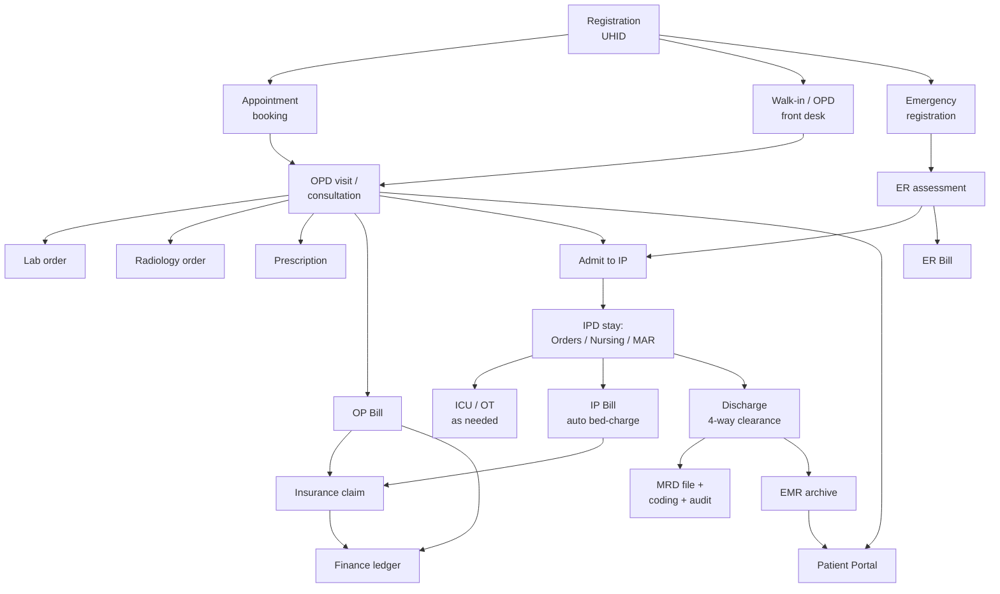

# Patient Journey — Gap Analysis

> Scope: this document traces the **operational flow of a patient through Prixo HIS** —
> registration → scheduling → consultation → orders (lab/rad/pharmacy) → billing →
> admission/IPD → nursing/ICU/OT → discharge → MRD/EMR → insurance/finance → portal/reporting
> — and flags every point where a handoff between modules is missing, manual, soft-linked, or
> a dead end. It does **not** re-litigate the phase-completion checklist (see
> `docs/MODULE_COMPLETION_STATUS.md`, which shows all 24 phases + extensions as ✅ against the
> plan's own checklist). A feature can be "complete" per its own module spec and still leave a
> gap in the *flow between* modules — that is what this document is for.
>
> Method: built from a close read of every `docs/modules/*.md` spec (each module's own
> "Deferred / notes" section, cross-referenced against its neighbors) plus `CLAUDE.md`'s
> project-status paragraph. Every finding below is traceable to an explicit statement in the
> current docs, not inferred from code. Docs are dated as recently as 2026-08-19; treat this as
> a snapshot and spot-check against code before acting on any item if material time has passed.
>
> Status key: 🔴 breaks or risks the flow silently · 🟡 works but needs a manual step / soft link
> · ⚪ deliberate, low-risk scope cut (listed for completeness, not urgency).

---

## 1. The journey, as built

Every arrow above exists in the codebase. The gaps below are about **how** each arrow is
crossed — automatically, by a manual re-entry, or not reliably at all.

---

## 2. Registration & identity

| # | Gap | Status | Detail |
|---|---|---|---|
| 2.1 | Duplicate detection is advisory only | 🟡 | `CheckDuplicatesAsync` scores candidates and shows a warning modal; front desk can override and register a second UHID for the same person. Nothing downstream reconciles two UHIDs for one physical patient except a manual merge later. (`patients.md`) |
| 2.2 | `IsBlocked` is a flag, not a gate | 🟡 **Picker visibility fixed 2026-09-16** | Blocking a patient sets a visible badge but **does not stop** registration, OPD visit creation, billing, or any other action anywhere in the system — this is confirmed deliberate (a hard block risks delaying care over a data flag), so it stays advisory-only by design; see §10 for the product-policy question this still leaves open. What *was* a real, undocumented gap: the shared `PatientPicker` (reused by nearly every module) never showed the flag at all when searching/selecting a patient, so staff had no way to even notice mid-workflow. Fixed in the one shared component — a "Blocked" badge in search results plus a warning once selected, reaching Appointments/OPD/Billing/IPD/Lab/Rad/Pharmacy/Emergency/Loyalty/Insurance/Nursing in one change. (`patients.md`) |
| 2.3 | ABHA linkage is real but inert | ⚪ | Full verify/link/create OTP flow exists (`abha_profiles`, `IAbdmGateway`) but returns a clear 400 until ABDM sandbox credentials are configured — no downstream module depends on it, so this doesn't break flow, just leaves the ABHA field usually empty. (`patients.md`) |
| 2.4 | No fuzzy name-only duplicate search | ⚪ | Duplicate prefilter requires an exact mobile or DOB match first; a patient with a changed mobile and unknown DOB won't surface as a duplicate candidate at all. (`patients.md`) |

---

## 3. Scheduling → arrival (Appointments / OPD / MHC / Camp / Emergency)

| # | Gap | Status | Detail |
|---|---|---|---|
| 3.1 | Follow-up advice doesn't book the follow-up | 🟡 | OPD's consultation workspace records follow-up date/notes but does **not** create an Appointment — it shows a note pointing staff back to the Appointments module. A missed second click loses the follow-up entirely, with no reminder that one was due. (`opd.md`) |
| 3.2 | Two disconnected MLC flags | 🟡 **Made queryable 2026-09-16** | OP registration has its own `IsMlcCase` tag; Emergency has a full statutory `MlcRecord` register. They stay deliberately separate concepts (confirmed intentional — an OP medico-legal tag isn't the same document as ER's statutory register), so this pass didn't merge them. What *was* a real gap: `IsMlcCase` was captured at registration with no screen anywhere to query it — effectively write-only. The OP Report now has an "MLC cases only" filter and an MLC column, so compliance staff can at least review OP-tagged cases as their own list. (`opd.md`) |
| 3.3 | `BookingType` vs. `AppointmentId` can disagree | ⚪ | OP registration's explicit `BookingType` field and the appointment-linkage inference are two independent signals; "nothing currently reconciles them if they disagree." Cosmetic/reporting risk only. (`opd.md`) |
| 3.4 | Queue Display isn't a real public kiosk | ⚪ | Runs under normal authenticated staff auth, not a low-privilege anonymous display session — an unattended waiting-room screen isn't actually deployable as designed. (`appointments.md`) |
| 3.5 | No MLC/accident register prints | ⚪ | Data and screens exist; no PDF print of the statutory registers yet. (`emergency.md`) |
| 3.6 | Front-desk max-advance-booking window only covers one path | ⚪ | `FrontOffice.MaxAdvanceBookingDays` is enforced only on staff "Book Appointment"; reschedule, ER token mapping, and Patient Portal booking bypass it by design — worth confirming this is the intended policy, since a patient could self-book further out than staff can. (`appointments.md`) |

---

## 4. Consultation → orders (the biggest cluster of soft links)

This is where the most re-entry risk lives: OPD's consultation workspace *records intent*
(orders, prescriptions) but three separate downstream modules (Lab, Radiology, Pharmacy,
Billing) each require a **second, independent data-entry step** by a different staff member,
with only a loose traceability pointer connecting them back to the visit.

| # | Gap | Status | Detail |
|---|---|---|---|
| 4.1 | Clinical orders don't create real Lab/Rad orders | 🟡 **Bridged 2026-09-16** | `OpVisit.ClinicalOrder` (Lab/Radiology/Procedure) is still free text with `Status = Ordered` and never auto-progresses on its own — but the Orders tab now has one-click "Order in Lab"/"Order in Radiology" actions that navigate to the Lab/Rad order screen with the patient and `ClinicalOrderId` prefilled (the same router-state prefill mechanism Emergency's STAT-order buttons already used), so the back-reference that closes the traceability loop is no longer something staff have to remember by hand. Staff still have to click through and pick the actual test(s) — nothing auto-generates a real order from the free-text description alone, and Procedure-type orders still have nowhere to bridge to. (`opd.md`, `lab.md`, `radiology.md`) |
| 4.2 | No "Generate bill" button from the consultation workspace | 🟡 | Explicitly still open per Billing's own doc: cashiers now find the visit via patient search (`OpBillingSearchPage`, closes the bigger "don't know the visit ID" problem) instead of the doctor's screen linking straight to billing. The doctor-side entry point is still missing. (`billing.md`) |
| 4.3 | Lab/Radiology order-to-bill link is unenforced | 🟡 **Made visible 2026-09-16** | `LabOrderItem.BillItemId` / equivalent is a **soft, nullable, unchecked** link — nothing blocks sample collection, result entry, verification, or approval on a test ever being billed, and this stays true by deliberate choice (a hard block risks delaying clinically-needed results over a billing formality). What's now closed: an "Unbilled Orders Report" on both Lab and Radiology surfaces every resulted-but-unbilled item, so the gap is no longer invisible even though it's still unenforced. Radiology previously had no billing link at all (not even Lab's soft one) — it now has the identical `BillItemId` field. See `docs/modules/lab.md`/`docs/modules/radiology.md`. |
| 4.4 | Prescription doesn't reach Pharmacy automatically | 🟡 **Bridged 2026-09-16** | `PharmacySale.PrescriptionId` is still an optional, unenforced link — but the Prescription tab now has a "Send to Pharmacy" action (once the prescription is saved) that opens the POS screen with the patient and every prescribed drug prefilled into the cart at a placeholder quantity, `prescriptionId` threaded through automatically on checkout. The pharmacist still sets real quantities and allocates against actual batches (FEFO) — nothing here auto-decides dispensed quantity or bypasses stock allocation. A walk-up sale with no matching prescription still isn't flagged either way. (`pharmacy.md`) |
| 4.5 | POS checkout still doesn't collect a payment mode | ✅ **Fixed 2026-09-17** | `PosSalePage` now has a required "Payment mode" selector (same `usePaymentModes` master as "Pharmacy Pay Type Modify") next to the Store field; Checkout is disabled until one is picked, and `CreateSaleRequest.PaymentModeId` carries the real selection instead of a hardcoded null. "Pharmacy Pay Type Modify" remains as a correction path, no longer the only way a sale gets a payment mode. (`pharmacy.md`) |
| 4.6 | IPD medication orders don't connect to Pharmacy stock at all | ✅ **Fixed 2026-09-16** | A doctor's structured `MedicationOrder` feeds Nursing's MAR (due-time schedule, administer/skip/refuse). Administering a dose can now optionally decrement stock: `MarAdministration` gained nullable `BatchId`/`Quantity`, and confirming an `Administered` dose against a picked batch writes a real `IssueOut` `StockLedger` row in the same transaction. **Deliberately still opt-in** — a nurse can always confirm a dose with no batch (clinical charting must never be blocked by inventory), so this closes the silent-divergence risk only for doses where a batch is actually picked; it does not force every administration to be stock-tracked. See `docs/modules/nursing.md`. |
| 4.7 | Allergy cross-check is real, but only where wired | ⚪ (resolved item, listed for completeness) | EMR's `CheckDrugAllergiesAsync` **is** live-wired into OPD's prescription tab (advisory banner, not a block) — this closes what OPD's own doc still describes as a deferred gap; the OPD module spec is stale on this point, EMR's is current. No equivalent check exists on IPD's medication-order form or Pharmacy's POS screen. |

---

## 5. Billing (cuts across every stage)

| # | Gap | Status | Detail |
|---|---|---|---|
| 5.1 | Insurance status isn't visible to the cashier at collection time | ✅ **Fixed 2026-09-16** | A pre-authorization can be raised and even approved against an OP visit or admission. `BillDetailDto` now carries `InsuranceStatus` (a not-yet-resolved claim, or else pre-auth, against this bill/encounter) rendered as a banner on `BillDetailPage`; `ClaimDto` now carries the bill's live paid/balance amounts, flagged on `ClaimsWorklistPage` when cash is already collected. **Advisory only, by design** — matches this codebase's existing `CreditLimit`/`CreditExposure` posture (a banner, not a gate); it doesn't hard-block collection or claim submission, so a determined double-settlement is still possible, just no longer invisible to staff. See "Insurance awareness on the bill" in `docs/modules/billing.md`. |
| 5.2 | IP discharge billing clearance is a manual tick, not a balance check | 🟡 **Made visible 2026-09-17** | The 4-way discharge checklist's Billing item still doesn't block on `Bill.BalanceAmount` — that stays a deliberate, user-confirmed choice (a hard gate would break legitimate LAMA / approved-pending-insurance / waived-balance discharges). What's fixed: `GET clearances` now returns the admission's live `BillBalanceAmount` on the Billing row, and the Discharge tab shows it in red when > 0 — staff self-certify with the real number in front of them instead of blind. A determined mis-click can still discharge with a balance due; it's no longer invisible while doing so. (`ipd.md`) |
| 5.3 | Consultation fee bypasses the Tariff engine entirely | ⚪ | Every other billable service resolves its rate through `Tariff` (branch/patient-category/effective-window); OP consultation fee is a flat per-doctor field with a separate hospital-wide fallback setting — two different pricing mechanisms for what a patient experiences as one bill. Not wrong, but worth knowing if consultation pricing needs the same category/date-window flexibility services get. (`opd.md`, `admin.md`) |
| 5.4 | Corporate/insurance credit exposure not fed back to IPD's credit-limit banner | ⚪ | `Admission.CreditLimit` warns against `BalanceAmount − available advances`; it doesn't factor in an approved-but-unsettled insurance claim amount, so a fully pre-authorized patient can still show as "over limit" with no distinction from a genuinely uncovered patient. |

---

## 6. Admission → IPD → Nursing → ICU/OT

| # | Gap | Status | Detail |
|---|---|---|---|
| 6.1 | Consent capture at admission has no document scan | ⚪ | The admission wizard only captures signed-by name + relationship as text; `PatientConsent.DocumentPath` supports a scan but that's only reachable via the patient's separate consent endpoint, not inline in the admit flow. Inconsistent with Radiology's dedicated `ContrastConsent` (which does gate on a real record) and Patient Registration's own consent capture (which does support a scan). (`ipd.md`) |
| 6.2 | OT post-op doesn't move the patient's bed | ⚪ | `PostOpNote.ShiftedAt` is just a timestamp; the actual ward/bed transfer is a separate, un-triggered IPD action — a patient can show "shifted" on the OT note while the bed board still shows them in the theatre's holding state. (`ot.md`) |
| 6.3 | No OT scheduling calendar / conflict view | ⚪ | Conflict-checking is real on the backend; there's no visual calendar, only a filterable list — a coordinator can't eyeball same-day theatre utilization. (`ot.md`) |
| 6.4 | ICU alert rules and MAR/vitals don't cross-notify Doctor Portal beyond the dashboard count | ⚪ | Doctor Portal's dashboard shows "unacknowledged critical lab alerts" but not unacknowledged ICU vitals-threshold alerts for the doctor's own patients — a severity spike could sit unseen by the attending doctor outside the ICU dashboard itself. (`icu.md`, `doctor-portal.md`) |
| 6.5 | MAR double-verification only covers `Administered`, and only for drugs flagged high-alert at generation time | ⚪ | If a drug's `IsHighAlert` flag is changed on the master *after* a MAR schedule row already exists, the in-progress schedule keeps its original snapshot — a newly-flagged high-alert drug won't retroactively require double-verification on doses already scheduled that day. (`nursing.md`) |

---

## 7. Discharge → MRD → EMR → Insurance → Finance

| # | Gap | Status | Detail |
|---|---|---|---|
| 7.1 | MRD's discharge file audit doesn't gate discharge | ⚪ (by design) | The 4-way clearance (Billing/Pharmacy/Nursing/FinalInvestigation) happens at discharge time; MRD's own completeness audit (summary signed / consents / notes / reports present) is filled in afterward and never blocks the discharge itself. This is deliberate per the build order (MRD exists *because* discharges already happen), but means an incomplete record can leave the building before MRD ever looks at it. |
| 7.2 | Problem list isn't populated from clinical diagnoses | 🟡 | EMR's patient-level Active/Resolved problem list is entirely manually curated — nothing copies a visit's `VisitDiagnosis` or a discharge summary's diagnosis into it. A doctor relying on the problem list for a quick "what does this patient have" view can miss anything not manually re-entered there. (`emr.md`) |
| 7.3 | Insurance claim only starts after a *finalized* bill | 🟡 | Claims submit against `billing.bills`, which in practice means the OP/IP billing cycle has to complete first — combined with 5.1 above, a cashless patient's bill can be fully collected in cash before/alongside a claim being worked, with nothing surfacing the conflict. (`insurance.md`) |
| 7.4 | Claim settlement posts to Finance only if accounts are configured | ⚪ | `PostClaimSettlementAsync` is a silent no-op on an unconfigured branch — same posture as every other `IFinanceLedgerPoster` hook, but worth confirming every live branch actually has its bank/cash accounts linked, or settlements won't reach the ledger at all with no error raised. (`insurance.md`, `finance.md`) |
| 7.5 | No claims aging/TAT report | ⚪ | The only visibility into stuck pre-auths/claims is the worklist tables themselves — no date-based aging report exists yet to catch a claim sitting in `UnderReview` too long. (`insurance.md`) |

---

## 8. Patient-facing continuity (Portal, notifications)

| # | Gap | Status | Detail |
|---|---|---|---|
| 8.1 | Appointment reminders are queued but never sent | ⚪ (verified, no code gap) | Every booking enqueues a row in `admin.notification_queue`; nothing dispatches it (Communication module held). Checked for a misleading UI claim and found none — no screen in the app mentions "reminder" at all, so there's no false promise to fix in-product; the gap is real but purely a backend placeholder, already documented honestly in `appointments.md`/`MODULE_COMPLETION_STATUS.md` §5. No action taken beyond confirming this. |
| 8.2 | "Pay Online" from the Portal is a request queue, not a payment | ✅ **Fixed 2026-09-16** | The patient-facing copy was already honest ("our billing team will contact you"), but **staff had no screen to see the queue at all** — `billing.online_payment_requests` had a write endpoint (Portal) and no read/action endpoint anywhere, so the promise was unfulfillable in practice. Added a staff worklist: `GET/POST /api/v1/billing/online-payment-requests` (+ `.../complete`, `.../cancel`), `BILLING.ONLINEPAYMENT.{VIEW,MANAGE}` (granted to Billing Executive/Supervisor and OP Billing), and an `OnlinePaymentRequestsPage` under the Billing menu. Still doesn't move money — staff collect payment the normal way on the bill and then close the request. (`portal.md`, `billing.md`) |
| 8.3 | Portal feedback doesn't reach Quality/NABH | ⚪ | Patient feedback still lands only in `patient.feedback`; Quality's non-conformance/incident intake doesn't ingest it automatically, so a pattern of bad feedback about one department won't surface in the Quality dashboard unless someone manually cross-reads both. (`portal.md`, `quality.md`) |
| 8.4 | Portal OTP login not implemented | ⚪ | Password-only for now, by design (scoped for "when SMS lands"). Fine as a deliberate scope cut, listed for completeness. (`portal.md`) |

---

## 9. Integration placeholders that affect real-world continuity

None of these break in-system flow, but each is a point where the *documented* system
capability (a real DB column/interface) can create a false impression that the capability is
live:

| # | Placeholder | Where it actually stops |
|---|---|---|
| 9.1 | Lab analyzer interface (`IAnalyzerInbound`) | Every lab result is manually keyed; no instrument ever posts a result automatically. (`lab.md`) |
| 9.2 | PACS/DICOM (`PacsStudyUid`, viewer URL setting) | Only the accession number is real; there is no image viewer, no DICOM listener — a radiologist reports from whatever imaging system exists outside Prixo, referencing the accession number by convention only. (`radiology.md`) |
| 9.3 | ICU device integration (`device_reading`, `IDeviceInbound`) | No monitor/ventilator ever writes a reading automatically; all ICU charting is manual entry. (`icu.md`) |
| 9.4 | Virus scanning on every upload surface (EMR/MRD/Insurance/Quality attachments) | `VirusScanStatus` stays `NotScanned` forever — any uploaded file (consent scan, discharge doc, claim document, NABH evidence) is stored and served without ever being scanned. (`emr.md`, `mrd.md`, `insurance.md`, `quality.md`) |
| 9.5 | Report subscriptions (`reporting.report_subscriptions`) | A user can "subscribe" to a scheduled report; nothing ever emails it — same outbox-with-no-sender pattern. (`reports.md`) |

---

## 10. Prioritized punch-list

Ranked by how much they can silently produce a wrong real-world outcome (patient sees/pays
something the system doesn't reflect, or a record goes uncaptured) rather than by effort:

1. ~~**4.6 — MAR administration doesn't touch Pharmacy stock.**~~ **Fixed 2026-09-16** — an
   Administered dose can now optionally decrement a picked batch's stock in the same
   transaction; see `docs/modules/nursing.md`.
2. ~~**8.2 — Portal "Pay Online" had no staff-side worklist.**~~ **Fixed 2026-09-16** — see
   above. (8.1, appointment reminders, was checked and found to have no misleading UI copy —
   no further action needed there beyond the existing documentation.)
3. ~~**5.1 — No cash-vs-cashless conflict check between Insurance and Billing.**~~ **Fixed
   2026-09-16** — both sides now surface the other's state as an advisory banner; see above.
4. ~~**4.3 — Unenforced billing link on Lab/Rad orders, with no way to even see it.**~~
   **Made visible 2026-09-16** — chosen deliberately as advisory-only (see the table above);
   an Unbilled Orders Report now exists on both Lab and Radiology.
5. ~~**2.2 — `IsBlocked` invisible in the shared patient picker.**~~ **Fixed 2026-09-16** —
   see above. The underlying product-policy question (should blocking ever hard-gate an
   action?) is confirmed intentional, not something this pass changed — flagged for a human
   decision if the hospital ever wants it to be more than advisory.
6. ~~**3.2 — `IsMlcCase` was write-only, with no report to query it.**~~ **Fixed 2026-09-16**
   — see above. Kept deliberately separate from Emergency's statutory register per the
   existing design decision.
7. ~~**4.1 / 4.4 — Order/prescription re-entry across OPD → Lab/Rad/Pharmacy.**~~ **Bridged
   2026-09-16** — one-click prefilled hops from the consultation workspace into all three
   downstream screens (Lab, Radiology, Pharmacy POS), reusing the same router-state prefill
   pattern Emergency's STAT-order buttons originated. Staff still pick the actual tests/drugs
   and quantities on the other end; this closes the re-entry/traceability risk, not full
   automation.
8. Everything in §9 (placeholders) — no action needed unless/until the corresponding
   integration is prioritized; listed so it's not mistaken for a bug when it surfaces in
   testing.
9. ~~**4.5 — POS checkout never collected a payment mode.**~~ **Fixed 2026-09-17** — added
   after the original eight once it was clear it was the only remaining 🔴 with no open policy
   question; see above.
10. ~~**5.2 — Discharge billing clearance is a self-certified checkbox, not a balance
    check.**~~ **Made visible 2026-09-17** — user chose advisory-only (matches this pass's
    established posture); the live bill balance is now shown on the checklist item, still not
    a hard gate. See above and §11.

---

## 11. Status as of this pass (2026-09-17)

All eight items on the original 2026-09-16 punch-list have been addressed — seven with real
product changes (backend + frontend + tests + docs, verified against a full build/test/lint
pass each time), one (§9 placeholders / appointment reminders) confirmed to need no code
change since no misleading UI claim exists. Every change kept to this codebase's existing
conventions: advisory banners over hard gates wherever a decision could delay care or payment,
additive/nullable schema changes over re-architecture, and the same router-state prefill idiom
(originated by Emergency's STAT-order buttons) reused three more times rather than inventing a
new mechanism per module.

A ninth item, **4.5 (POS checkout not collecting a payment mode)**, was still 🔴 after that
pass — it wasn't on the original punch-list but was the last remaining 🔴 that didn't carry a
policy question, so it was fixed the same day as a follow-on: `PosSalePage` now has a required
payment-mode selector at checkout, reusing the same `usePaymentModes` master "Pharmacy Pay
Type Modify" already used. See `docs/modules/pharmacy.md`.

The last item, **5.2 (IP discharge billing clearance is a self-certified checkbox, not a real
balance check)**, was deliberately not changed until a human made the policy call — unlike
every other item closed in this pass, hard-gating discharge on `Bill.BalanceAmount == 0` would
be a genuine behavior change to a hospital workflow (LAMA, approved pending-insurance
discharges, and waived-balance cases all need to still be dischargeable), not a pure visibility
fix. Asked, and the user chose advisory-only, consistent with this pass's posture elsewhere:
the Billing clearance row now surfaces the admission's live bill balance, but clearing still
isn't blocked on it. **No 🔴 items remain open** as of this pass.

Remaining work — everything still marked 🟡/⚪ inside the tables above — is either a deliberate,
documented scope cut (not a bug) or a smaller, self-contained follow-up (e.g. a claims-aging
report, exposing `linkedAccountId` in the Payment Modes UI) that doesn't block anything else on
this list.

---

*Compiled 2026-09-16, updated 2026-09-17, from `docs/modules/*.md` and `CLAUDE.md`. Each
finding cites its source doc(s) — re-verify against current code before treating any item as
still open, since these specs are maintained by hand alongside the code and could have
drifted.*
